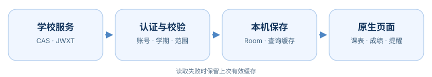

<div align="center">

<h1>Gnomon 课程表</h1>
<p>川职课表同步、课程编辑与课前提醒。</p>

[](https://github.com/zwwd1/gnomon-timetable/releases/tag/v1.2.17)

[](LICENSE.md)

**[下载 APK](#download) · [界面预览](#screenshots) · [功能总览](#features) · [第一次使用](#start) · [常见问题](#faq) · [文档](#docs)**
</div>

Gnomon 是一款适配川职教务的 Android 课表应用。同步课程后，可以查看每周安排、教室和老师，也能自己编辑课表、调整作息和设置提醒。没网时，已经保存的课表照常能看。

项目基于 [SleepDown 课程表](https://github.com/xiaomanjun233/SleepDown-Schedule) 修改，由 zwwd1 维护川职适配，非学校官方应用。原作者和许可说明见[来源与许可](#credits)。

<details>
<summary><strong>目录</strong></summary>

- [下载与安装](#download)
- [界面预览](#screenshots)
- [功能总览](#features)
- [第一次使用](#start)
- [外观与设置](#appearance)
- [Gnomon 与 Lumen 怎么选](#compare)
- [数据与隐私](#privacy)
- [实现与构建](#build)
- [维护情况](#maintenance)
- [常见问题](#faq)
- [文档](#docs) · [来源与许可](#credits)

</details>

---

<a id="download"></a>

## 下载与安装

| 当前版本 | 安装包 | 适用设备 |
| :--- | :--- | :--- |
| **[1.2.17](https://github.com/zwwd1/gnomon-timetable/releases/tag/v1.2.17)** | [下载通用 APK](https://github.com/zwwd1/gnomon-timetable/releases/download/v1.2.17/Gnomon-Timetable-1.2.17.apk) · 14.39 MiB | Android 13 及以上，通用包 |

[SHA-256 校验](https://github.com/zwwd1/gnomon-timetable/releases/download/v1.2.17/Gnomon-Timetable-1.2.17.apk.sha256) · [构建来源](https://github.com/zwwd1/gnomon-timetable/releases/download/v1.2.17/BUILD_PROVENANCE.json) · [对应源码](https://github.com/zwwd1/gnomon-timetable/tree/828f4a988931f08b54438957eab969062fe347b6) · [历史版本](https://github.com/zwwd1/gnomon-timetable/releases)

已安装本项目旧版时，下载正式包覆盖更新即可，通常不需要卸载。正式包沿用原包名与签名；自行换签名的构建不能直接覆盖，更新前建议备份课程。

---

<a id="screenshots"></a>

## 界面预览

<table><tr>
<td align="center"><br><b>周课表</b><br>点按查看详情，长按编辑课程。</td>
<td align="center"><br><b>个人中心</b><br>设置、更新、导入和导出。</td>
<td align="center"><br><b>材质设置</b><br>调整材质质量和入场动画。</td>
</tr></table>

配图拍摄于 **2026-10-17，Redmi K40 / Android 13，Gnomon 1.2.14**。画面来自实际应用，操作说明见[图文上手](docs/SCVTC_USAGE.md)。

---

<a id="features"></a>

## 功能总览

| 课程安排 | 教务与离线数据 | 外观与工具 |
| :--- | :--- | :--- |
| 日 / 周课表、教师与教室 | 川职认证与课表同步 | 液态 / 高斯 / 柔光材质 |
| 点按查看、长按编辑 | 成绩、学期与学分查询 | 完整 / 均衡 / 低负载质量 |
| 多课表、作息与课程提醒 | 已保存课表离线查看 | 入场动画与系统动画状态 |
| 桌面组件与今日课程 | 按账号、学期保存记录 | JSON / ICS、本机备份及手动 WebDAV |

课程详情、编辑、作息和提醒围绕原生课表展开；同步失败时保留上次成功保存的课程。具体入口见[图文上手](docs/SCVTC_USAGE.md)和[功能范围](docs/GNOMON_1.2.14.md)。

---

<a id="start"></a>

## 第一次使用

1. 安装后打开“连接川职教务”，输入学号和学校统一认证密码。需要验证码或安全确认时，在应用里的学校认证页完成。
2. 到 **个人中心 → 当前课表详细设置**，核对开学日期和节次时间，再开启课前提醒。
3. 在底栏 **课表** 查看课程：点按看详情，长按编辑；**成绩查询** 中可切换学期、搜索和筛选记录。
4. 需要备份时，到个人中心选择 **课表导出** 或 **课表备份与恢复**。JSON / ICS 适合导出课程，完整备份用于保留更多本机设置。

后续会尝试恢复已过期的登录会话；改密码、换手机或学校要求人工验证时，需要重新认证。详细步骤和截图见[使用说明](docs/SCVTC_USAGE.md)。

---

<a id="appearance"></a>

## 外观与设置

在 **个人中心 → 应用偏好设置** 中调整：

- **底部导航**：默认是成绩查询、课表和个人中心，可按需增减入口。
- **玻璃材质**：液态、高斯、柔光分别保存参数，预览后点“应用”才会保存。
- **材质质量**：完整、均衡、低负载三档；启动时临时降低质量和入场动画另有开关。

系统动画时长设为 0 时，部分过渡会直接完成。偏好页可以查看系统动画状态并打开相关设置。文件导入、导出和手动 WebDAV 的操作见[使用说明](docs/SCVTC_USAGE.md)。

---

<a id="compare"></a>

## Gnomon 与 Lumen 怎么选

| 你更常做什么 | 本仓库：Gnomon | [Lumen](https://github.com/zwwd1/lumen-timetable) |
| :--- | :--- | :--- |
| 安排上课日常 | 课程编辑、作息、提醒和桌面组件 | 也保留编辑、提醒和组件 |
| 集中查看教务 | 课表与常用成绩查询 | 课表、成绩、考试、学分和校园服务 |
| 使用已有记录 | 课表离线可看 | 查询结果本机缓存 |

两款可以同时安装，账号、课表和设置分别保存，不会自动互相同步。

---

<a id="privacy"></a>

## 数据与隐私

学校登录和教务查询直接连接学校服务。密码和可恢复会话加密保存在手机里，普通课表导出不包含学校凭据。课程和作息存放在应用私有数据库中；普通课程记录没有做逐字段加密。

上游云同步和匿名统计目前暂停。AI 和手动 WebDAV 需要自行配置，使用时会连接相应服务。导出的课表可能包含教师、教室和课程安排，分享前请自行检查。具体保存方式见[隐私说明](docs/SCVTC_PRIVACY.md)。

---

<a id="build"></a>

## 实现与构建

Kotlin / Compose 承载界面、编辑与提醒，Room 保存课程和配置。川职认证和查询位于 `cn/scvtc/campus`，课程校验规则在 `school-core`。会话优先复用，需要时尝试重新认证；读取失败保留上次课表，写入前分别校验账号与学期。



### 自行构建

准备 **JDK 21、Android SDK 37**，配置 `JAVA_HOME` 与 `ANDROID_HOME`，使用仓库的 Gradle Wrapper：

```powershell
git clone https://github.com/zwwd1/gnomon-timetable.git
cd gnomon-timetable
.\gradlew.bat :app:assembleGithubRelease
```

构建沿用仓库的 Gradle Wrapper，以及项目附带的 Miuix / Backdrop 补丁来源。发布签名配置放在仓库外；完整工具链和签名变量见[构建与实现](docs/SCVTC_ARCHITECTURE.md)。

复现当前正式包时使用版本标签 `v1.2.17`，也可直接查看[发行对应源码](https://github.com/zwwd1/gnomon-timetable/tree/828f4a988931f08b54438957eab969062fe347b6)。自行签名不等于原签名覆盖升级。

---

<a id="maintenance"></a>

## 维护情况

这是个人维护的项目，更新没有固定时间。学校调整登录或教务接口后，部分功能可能暂时用不了。遇到问题可以提 Issue，附上版本、机型和复现步骤；想自己修改，也欢迎 fork。

<details>
<summary><strong>目前测过哪些情况？</strong></summary>

1.2.17 的正式包在 Redmi K40 / Android 13 上做过覆盖升级和部分页面检查。全新安装、其他 ROM、长时间熄屏、重启后的后台任务、通知和组件更新还没有全部测过。

测试过程和未完成项见 [VERIFICATION.md](VERIFICATION.md)，安装包与源码的对应关系见 [BUILD_PROVENANCE.json](BUILD_PROVENANCE.json)。

</details>

---

<a id="faq"></a>

## 常见问题

<details>
<summary><strong>已有账号和课表，升级需要卸载吗？</strong></summary>

不需要。使用本项目原签名的正式包覆盖安装，并确认没有降级。如果提示签名不一致，先核对下载来源。卸载或清数据会删除本机密钥，之后需要重新登录。

</details>

<details>
<summary><strong>为什么还会要求学校验证码或重新认证？</strong></summary>

应用会尝试恢复普通过期会话；学校要求验证码、安全确认或其他本人操作时，仍需在官方认证页完成。失败时保留离线记录，不要反复提交密码。

</details>

<details>
<summary><strong>为什么后台同步不是准点发生？</strong></summary>

Android、电量、网络和厂商后台限制会影响调度。已有课程可从本机读取，需要最新教务信息时手动刷新。设置与故障处理见[图文上手](docs/SCVTC_USAGE.md)。

</details>

---

<a id="docs"></a>

## 文档

[打开文档目录](docs/README.md)：使用说明、隐私、开发和历史记录分开查阅。

| 想了解什么 | 阅读入口 |
| :--- | :--- |
| 登录、课程操作和故障处理 | [图文上手](docs/SCVTC_USAGE.md) |
| 作息、材质、文件和入口范围 | [1.2.14 功能说明](docs/GNOMON_1.2.14.md) · [作息设置](docs/PERIOD_SCHEMES_GUIDE.md) |
| 本版改动与历史版本 | [1.2.17 更新说明](release-notes/v1.2.17.md) · [全部发行记录](https://github.com/zwwd1/gnomon-timetable/releases) |
| 认证、数据流程与构建 | [构建原理](docs/SCVTC_ARCHITECTURE.md) · [开发文档目录](docs/README.md) |
| 数据保存与实际验证 | [隐私说明](docs/SCVTC_PRIVACY.md) · [验证记录](VERIFICATION.md) |
| 项目来源与许可 | [原项目介绍](docs/UPSTREAM_README.md) · [许可证](LICENSE.md) · [第三方说明](THIRD_PARTY_NOTICES.md) |

---

<a id="credits"></a>

## 来源与许可

本项目基于 [SleepDown课程表](https://github.com/xiaomanjun233/SleepDown-Schedule) 修改，原作者 **xiaomanjun233**；川职适配由 **zwwd1** 维护。原许可、版权和第三方说明完整保留：[LICENSE.md](LICENSE.md) · [THIRD_PARTY_NOTICES.md](THIRD_PARTY_NOTICES.md)。界面组件感谢 Miuix 与 AndroidLiquidGlass。
