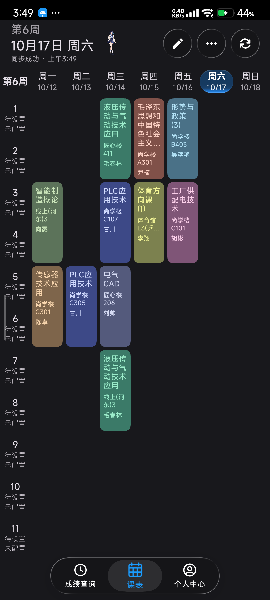
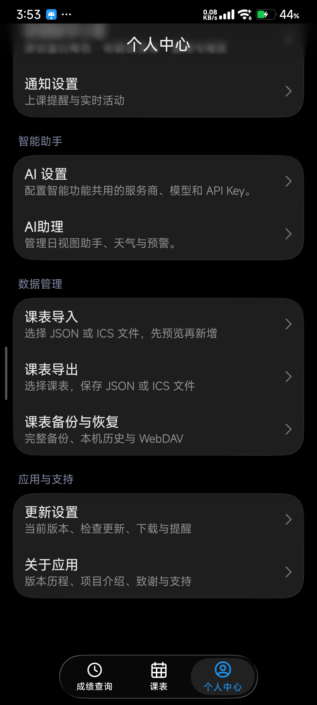
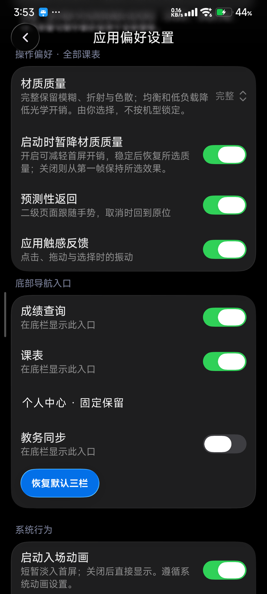

<h1>Gnomon 课程表</h1>

今天去哪间教室，一眼就能找到。

**[下载 APK](https://github.com/zwwd1/gnomon-timetable/releases/latest) · [图文上手](docs/SCVTC_USAGE.md) · [更新记录](https://github.com/zwwd1/gnomon-timetable/releases) · [反馈问题](https://github.com/zwwd1/gnomon-timetable/issues)**

只是想查一节课，智慧川职却常让我来回找入口，用久了挺烦的。于是按自己的习惯做了 Gnomon：课表、教室、老师、作息和提醒，放在顺手的位置。这是自己随心而动的作品，希望能帮到川职院的同辈。

> 本项目基于 [SleepDown课程表](https://github.com/xiaomanjun233/SleepDown-Schedule) 修改；原作者：**xiaomanjun233**。这是 zwwd1 维护的非官方修改版，加入川职认证与同步、成绩查询、数据保护及本机文件管理，与学校和原作者均无官方关系。

## 先看界面

<table><tr>
<td align="center"> <b>一周安排</b> 点课程放大，长按再编辑。</td>
<td align="center"> <b>常用入口</b> 偏好、更新、关于、导入和导出。</td>
<td align="center"> <b>效果自己选</b> 完整材质、低负载和入场动画。</td>
</tr></table>

以上来自 Redmi K40 / Android 13；拍摄版本与日期见[图文说明](docs/SCVTC_USAGE.md)。

## 第一次用，按这几步来

| 步骤 | 在哪里点 | 完成后能看到什么 |
| --- | --- | --- |
| ① 连接学校 | 首次邀请 → 连接川职教务 → 输入学号、学校密码 | 核验后保存课表；密码按账号加密留在本机 |
| ② 看课程 | 底栏 **课表** → 日 / 周 → 点课程 | 放大查看课名、教师和地点；长按才编辑 |
| ③ 校对时间 | 个人中心 → 课表详细设置 | 核对开学日期和节次时间，再启用提醒 |
| ④ 查成绩 | 底栏 **成绩查询** | 先显示本机记录，可换学期、搜索和筛选 |
| ⑤ 留备份 | 个人中心 → 课表导出 / 课表备份与恢复 | 导出 JSON / ICS，或完整备份；导入先预览 |

学校要求验证码或安全确认时，进入应用里的**学校认证页**完成。普通会话到期会尝试恢复，学校强制的人工验证仍需本人操作。不要反复提交密码，也不用卸载清数据。[连接与故障处理](docs/SCVTC_USAGE.md)

## 哪款适合我

| | **Gnomon** · 本仓库 | [**Lumen**](https://github.com/zwwd1/lumen-timetable) |
| --- | --- | --- |
| 侧重 | 课程编辑、作息、提醒、桌面组件 | 课表、成绩、考试、学分和校园服务 |
| 使用习惯 | 围绕课程表安排日常 | 集中查看教务信息 |
| 数据 | 川职账号；课表离线可看 | 川职账号；查询结果本机缓存 |

选一款就够，也可以同时安装；两款各自保存数据。Gnomon 支持 Android 13 及以上，下载页提供一份通用 APK。正式包沿用原包名与签名，可保留数据覆盖安装。

## 外观、动效和文件

- **默认三栏**：成绩查询 / 课表 / 个人中心。个人中心 → 应用偏好设置可增减入口。
- **三种材质**：液态、高斯、柔光分别保存参数；预览后点应用，取消不会写入。恢复默认液态会回到原组件配方。
- **完整效果由你选择**：材质质量可选完整、均衡、低负载；启动期间是否暂降材质质量另有开关。入场动画也能单独关闭。
- **看不到动画时**：系统“动画时长缩放”设为 0 时，应用会遵循。偏好里提供系统状态与设置入口。
- **文件留在手上**：JSON / ICS 导入导出、本机备份历史、手动 WebDAV；学校密码不进入普通导出。

[入口与使用范围](docs/GNOMON_1.2.14.md) · [隐私说明](docs/SCVTC_PRIVACY.md) · [本版改动](release-notes/v1.2.14.md)

## 我会一直维护吗

不会实时维护，更新要看自己的时间和精力。学校哪天换接口或认证方式，它可能就失效了，也不保证马上有人修。源码和构建方法都留着；需要的话 fork 一份，**自行 vibe coding**，按自己的习惯继续改。

## 想接着改

Kotlin / Compose 承载界面、编辑与提醒，Room 保存课程和配置。川职认证和查询位于 cn/scvtc/campus，课程规则在 school-core。会话优先复用，需要时尝试重新认证；读取失败保留上次课表，分别校验账号与学期。云服务和匿名统计暂停，AI 需自行配置服务。

JDK 21、Android SDK 37 和仓库的 Gradle Wrapper：

~~~powershell
.\gradlew.bat :app:assembleGithubRelease
~~~

[构建与实现](docs/SCVTC_ARCHITECTURE.md) · [验证范围](VERIFICATION.md) · [对应版本源码](https://github.com/zwwd1/gnomon-timetable/tags)

自行签名的包不能覆盖正式包。签名配置放在仓库外。原许可、版权及第三方说明完整保留：[LICENSE.md](LICENSE.md) · [THIRD_PARTY_NOTICES.md](THIRD_PARTY_NOTICES.md)。界面组件感谢 Miuix 与 AndroidLiquidGlass。
