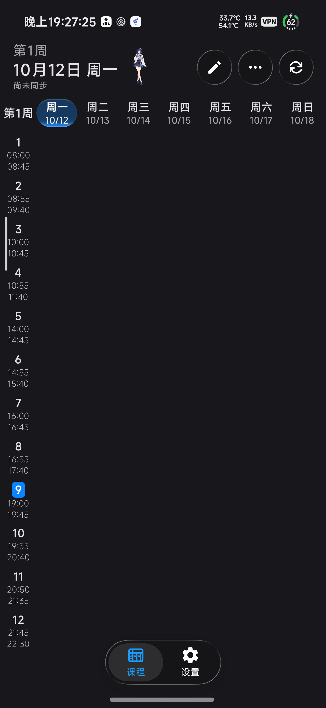
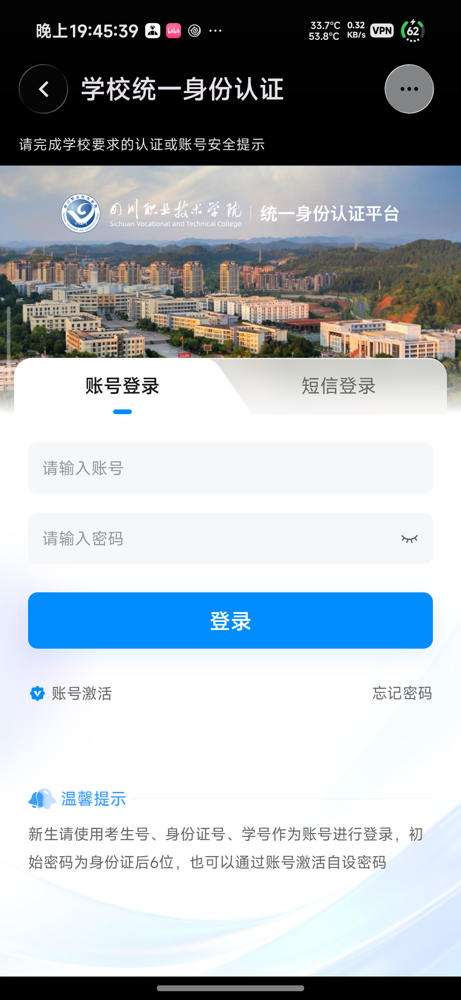

# Gnomon 课程表

用智慧川职的时候，有些地方真的挺让人烦的。只是想看一眼课表，还得来回找入口；登录和页面又常常不太顺手。我就按自己的习惯，折腾了这份 Gnomon 课程表。

这是自己随心而动的作品，希望也能帮到川职院的同辈，少折腾一点。它基于 SleepDown-Schedule，保留课程编辑、作息、提醒、小部件和玻璃界面，再接上川职教务、成绩与学分。

我不会实时维护这个应用。学校哪天换了登录方式或接口，它可能就失效了；到时不一定能及时修。源码在这里，有兴趣就 fork 一份，自行 vibe coding，按自己的需要改。

[下载 APK](https://github.com/zwwd1/gnomon-timetable/releases/latest) · [反馈问题](https://github.com/zwwd1/gnomon-timetable/issues) · [更新记录](release-notes/v1.2.13.md)

## 看图上手

<p align="center">


</p>

[图文使用说明](docs/SCVTC_USAGE.md) 按连接学校、查看课程、设置提醒和处理同步问题讲解。截图来自 10 月 12 日实机，早于本次英文改名与使用指南更新；图中的作息不是学校官方时间。

## 能做什么

首次安装会邀请你连接川职教务。填写学号和学校密码后，身份核验通过便返回应用，课表和成绩随后同步；密码加密留在手机，登录过期时尝试自动恢复。等待中可以取消或打开官方页面，验证码和账号安全提示在学校页面完成。

课表保存在本机，没网也能查看。可以切换日视图和周视图、调整开学日期与节次时间、添加课程、设置提醒和桌面组件。同步学校变更时保留本地编辑。成绩先读缓存，首次取得成绩后立即展示，毕业学分要求随后更新。

液态、高斯、柔光三种材质分别记住参数，壁纸、效果和布局可以先预览再应用。内置背景采用留白设计，也能换成自己的照片。启动入场动画、触感、时间栏、休息分隔和底栏入口可以自行调整。AI 助手需要配置自己的模型服务，课程授权默认关闭。

1.2.13 理顺了作息的查看与编辑入口，补上时间栏和午休、晚休分隔。数据管理支持 JSON / ICS 预览与导出、本机备份历史和手动 WebDAV 备份；[入口与使用范围](docs/GNOMON_1.2.13.md)写清了各自保存什么。

[使用方法](docs/SCVTC_USAGE.md)

## 实现

`cn/scvtc/campus` 连接学校 CAS 与真实教务接口；`com/xiaomanjun/sleepdownschedule` 承载课表界面、编辑和提醒；`school-core` 处理课程、学分与导入规则。认证页面只负责建立会话，学生身份接口确认账号后才保存连接。

课表写入 Room，成绩与学分单独缓存。密码、会话和成绩缓存通过 Android Keystore 与 AES-GCM 按账号加密，普通导出不含登录凭据。云服务与匿名统计暂停，数据默认留在本机。

[构建原理](docs/SCVTC_ARCHITECTURE.md) · [隐私说明](docs/SCVTC_PRIVACY.md)

## 自行构建

使用 JDK 21、Android SDK 37.0 与仓库中的 Gradle Wrapper：

```powershell
.\gradlew.bat :app:assembleGithubRelease
```

正式包沿用第一版包名和签名，可以保留数据覆盖安装。自行签名的 APK 无法覆盖正式包；签名配置需放在仓库外，具体方式见构建说明。

[GitHub Release](https://github.com/zwwd1/gnomon-timetable/releases) 提供安装包、源码标签与 SHA-256。[验证记录](VERIFICATION.md) 区分构建检查与实机结果。

## 致谢项目

[SleepDown-Schedule](https://github.com/xiaomanjun233/SleepDown-Schedule)、Miuix 与 AndroidLiquidGlass。项目与第三方组件的许可见 [LICENSE.md](LICENSE.md) 和 [THIRD_PARTY_NOTICES.md](THIRD_PARTY_NOTICES.md)。
