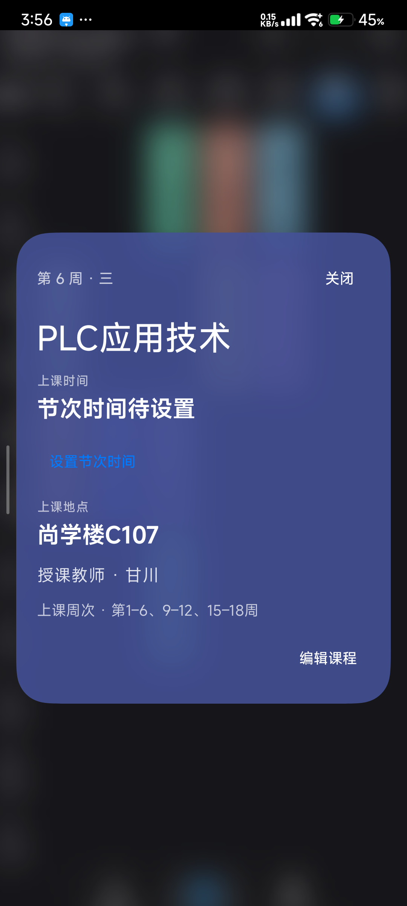

# Gnomon 使用说明

## 第一次打开：按六步指南操作

首次没有账号和课程时，应用会显示六步中文指南：连接学校、查看与编辑课程、校准日期与提醒、处理同步结果、备份迁移、调整材质和动效。可用“下一步 / 上一步”翻阅，正文可滚动；“稍后再看”允许先进入应用。指南中途的页码会在界面重建时保留。

以后随时到 **个人中心 → 使用指南** 重新查看，跳过首次提示也能找回来。指南最后可连接教务；已有账号只想重看说明时，点“完成”即可。实际课表和同步结果以学校返回、应用保存成功为准。

本文配图拍摄于 2026-10-17，Redmi K40 / Android 13，Gnomon 1.2.14。画面来自实际应用，不展示登录凭据。课程和作息以自己的学校返回结果为准。

## 1. 连接川职教务

新装且没有账号和课程时，首次邀请会带你进入“连接川职教务”。已有应用直接覆盖安装；不要为了更新卸载或清数据。

输入川职学号和学校统一认证密码，点“登录并自动同步”。密码按账号加密记在这台手机里，身份核验成功后课表、成绩继续在后台读取。已有课程可以先看。

学校要求验证码或账号安全确认时，点“打开学校认证页”，在学校页面完成。应用不会代替你跳过学校强制验证。普通会话到期会尝试恢复；改学校密码、换手机或清数据后需要重新连接。

以后连接入口：**个人中心 → 自动刷新课表 → 重新登录**。看“最近刷新”和结果提示判断是否完成，不用连续点提交。

## 2. 查看和编辑课程

底栏“课表”查看日常安排。切换日 / 周视图或教学周，点一节课会放大显示课程、教师、地点和时间。长按课程进入编辑。

详情提示“节次时间待设置”时，从提示进入补填，或到**个人中心 → 当前课表详细设置**核对开学日期、节次数量和作息。学校未提供节次时间时，请按实际作息填写，再启用提醒并允许通知。

## 3. 成绩、文件与备份

| 想做什么 | 入口与操作 |
| --- | --- |
| 看成绩 | 底栏 **成绩查询**；已有记录先显示，学期切换和筛选使用本机数据 |
| 更新课程 | **自动刷新课表** → 立即刷新；自动周期可选每天、每七天或从不 |
| 导入课程 | **课表导入** → 选 JSON / ICS → 看预览 → 确认新增课表 |
| 导出当前课表 | **课表导出** → 选课表和格式 → 在系统文件选择器中保存 |
| 做完整备份 | **课表备份与恢复**；本机历史或手动 WebDAV，可先浏览再恢复 |
| 更新应用 | **更新设置** → 检查 → 查看改动 → 下载 → 系统确认安装 |
| 找日志与来源 | **关于应用**；更新历史联网补充，离线保留已有说明 |

导入不会直接覆盖原表。普通导出不带学校密码。WebDAV 由你配置并手动触发；两款应用不共享账号或自动合并课表。

## 4. 材质与动画设置

**个人中心 → 应用偏好设置**：

- 材质质量选“完整”，保留模糊、折射与色散；“均衡”和“低负载”降低光学开销。
- “启动时暂降材质质量”可单独关闭，从首屏开始保持所选效果；入场动画另有开关。
- “玻璃材质”提供液态、高斯、柔光。先预览，点“应用”才保存；“取消预览”不覆盖设置。恢复默认液态沿用原组件的配方。
- 底栏默认“成绩查询 / 课表 / 个人中心”，可自行增减；个人中心固定保留。

**系统动画也要开启。**系统“动画时长缩放”为 0 时，两版都会直接完成部分过渡。偏好中的“系统动画”显示当前状态，并可打开系统设置；想看完整过渡，将系统该项调至 1 倍。应用不会擅自改系统倍率。

## 常见问题

| 看到的情况 | 下一步 |
| --- | --- |
| 本周空白 | 核对所选学期、周次与首周日期；真实空周也可能没有课 |
| 学校需要补充认证 | 进入官方页面完成要求，再回应用刷新；保留旧课表 |
| 官方页显示 nginx / An error occurred | 右上角三点 → 返回教务首页；已有认证时可继续，不必反复输入密码 |
| 离线或请求失败 | 已读到的课表仍可查看，恢复网络后再重试 |
| 当前学期没有成绩 | 切换往期或总体；“无记录”和“读取失败”是不同状态 |
| 后台没及时更新 | 检查联网、自启动和后台电量策略；系统可能延后任务 |
| 改了学校密码 | 进入重新登录，更新本机记住的密码 |
| 想换手机 | 导出课程和设置，在新手机重新登录；旧密文不能代替认证 |

反馈问题时请附版本、机型、复现步骤和相关错误，并隐藏账号、密码、Cookie 及个人成绩。维护安排见[项目首页](../README.md#maintenance)。

## 小米手机的后台同步

2026-10-17 的 Redmi K40 测试中，系统默认使用“智能限制后台运行”。如果后台更新经常延迟，可以长按桌面应用图标 → 应用信息，打开“自启动”；进入“电量消耗”，将省电策略改为“无限制”。不同系统的菜单名称可能不同。两款应用需要分别设置；取消电量限制可能增加耗电，可按需改回。即使开启，联网、认证状态和系统调度仍会影响更新时间。

[回到首页](../README.md) · [构建与数据流程](SCVTC_ARCHITECTURE.md) · [隐私说明](SCVTC_PRIVACY.md)
